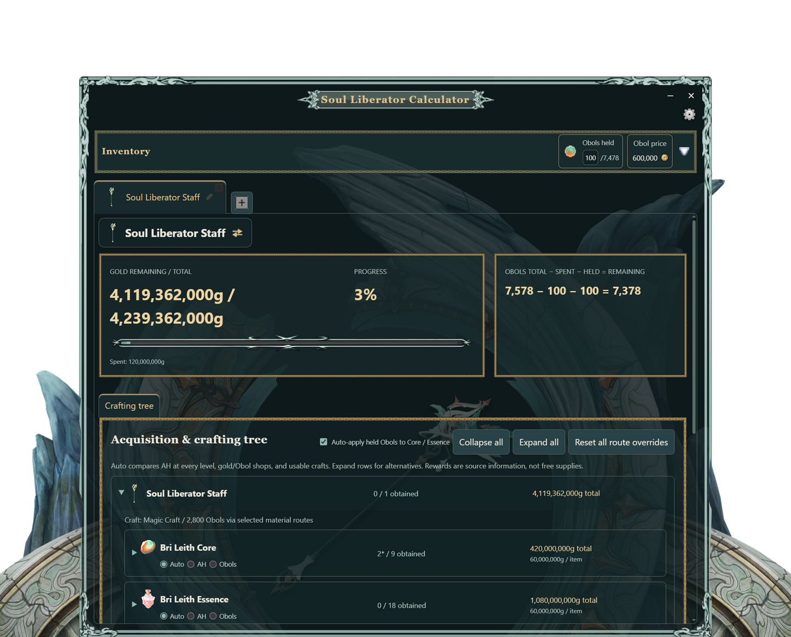

# Soul Liberator Calculator & Tracker

A crafting calculator and progress tracker for **Mabinogi** players working toward
Soul Liberator equipment. Plan your materials, compare costs, and keep track of what
you still need.



## What you can do

- Plan any of the 29 Soul Liberator weapons.
- Follow the full material and crafting tree.
- Enter your Auction House prices and compare buying versus crafting.
- Let the app choose cheaper routes, or override individual materials.
- Track owned materials and held Bri Leith Obols across multiple weapon tabs.
- See remaining gold costs and material progress; completed items turn gold.
- Keep your progress between sessions and undo accidental data edits.

## Run the app

On Windows, extract **Soul-Liberator-Calculator-0.1.0-x64.zip** into a writable folder,
then open **Soul Liberator Calculator.exe** inside it. Keep all the extracted files.
No installer, Node.js or game client is needed. Saves are kept in
**soul-liberator.sqlite**, beside the EXE. Keep both together when moving or backing
up the app. Settings, collapse states, caches, logs and temporary app files stay in
**.app-data** alongside it. Back up the save file and .app-data folder; preserve both
when updating. There is no app-data fallback or installer.

The EXE is unsigned; Windows may show a SmartScreen warning. Only run a copy
from a source you trust.

To run from source, install **Node.js 24.18 or newer**, then use:
```powershell
npm ci
npm run desktop:start
```

To build the Windows app folder and ZIP yourself, run `npm run package:win`.
The result appears in `release`.

## Getting started

1. Create a tab and choose your Soul Liberator weapon.
2. Enter the materials and Obols you already have in **Inventory**.
3. Set your material prices and gold value per Obol.
4. Expand the crafting tree to compare routes and choose overrides.
5. Update your inventory as you gather materials.

Use the **i** bubble at the top right of a material chip to view its sources and recipe details.

Drag the title or protruding gate to move the window. Drag the panel edges to resize it.
The gear button contains undo/redo controls and shortcut settings.
Shortcut edits save when you press Enter or leave the field; invalid shortcuts show an error.
Settings and display toggles reuse material price previews instead of recalculating every material.
It also lets you hide the protruding gate decoration while keeping the faded interior artwork.
With it hidden, the transparent space outside the panel lets clicks reach windows behind it.
Window size is remembered between sessions. Material counts, prices, tabs and settings
save automatically; number fields save when you press Enter or leave the field.

## Keep in mind

- Costs are planning estimates, not guaranteed crafting outcomes.
- Crafting success, failure losses and quality rolls are not modeled.
- Missing prices count as zero estimates and are marked with `*`; enter prices for useful totals.
- Reward listings show possible sources, not guaranteed drops.
- Metal Conversion recipes are included, using player-confirmed recipe quantities.
- The held-Obol counter shows the all-Obol material requirement. The tree shows spending
  for your selected routes, so buying materials with gold can make those numbers differ.

Unofficial fan project; not affiliated with Nexon. Mabinogi artwork belongs to its
respective owners.

Project code is [MIT licensed](LICENSE). See [third-party notices](THIRD_PARTY_NOTICES.md)
for artwork and dependency exclusions.
